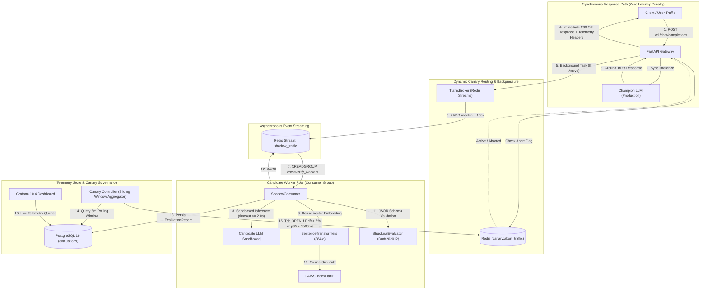

# Project CrossVerify: Dual-Path LLM Verification Engine
### Enterprise-Grade Continuous Verification, Shadow Routing & Automated SLO Canary Governance for Production AI Agents

[](#1-system-overview--architecture)
[](https://fastapi.tiangolo.com)
[](https://redis.io)
[](https://www.postgresql.org)
[](https://github.com/facebookresearch/faiss)
[](https://huggingface.co/sentence-transformers/all-MiniLM-L6-v2)
[](https://grafana.com)
[](https://www.docker.com)
[](tests/)

---

## Executive Summary

Deploying updated Large Language Models (LLMs) or agentic reasoning checkpoints into high-volume production environments is fraught with operational risk. Unlike deterministic software services where unit and integration tests validate binary correctness, LLMs are subject to **stochastic drift**, **hallucinations**, **latent semantic regressions**, **unparseable structured outputs**, and **latency spikes**.

**CrossVerify** is an enterprise continuous verification and safe-deployment engine built to solve this problem at scale. It validates new **Candidate LLMs** against baseline **Champion LLMs** by mirroring live production traffic asynchronously. CrossVerify guarantees:
1. **Zero User Latency Penalty:** Live user requests are routed synchronously to the production Champion model and returned immediately; shadowing runs strictly out-of-band.
2. **Semantic & Structural Discrepancy Verification:** Compares responses using dense vector embeddings (384-d `all-MiniLM-L6-v2`) via hardware-accelerated FAISS inner-product cosine similarity and rigorous JSON schema validation.
3. **Statistical Canary Circuit Breaker:** Dynamically computes rolling 5-minute telemetry windows in PostgreSQL. If semantic drift exceeds 5.0%, candidate p95 latency spikes beyond 1500ms, or candidate error rates exceed 5.0%, an abort flag is flipped in Redis to immediately halt traffic shadowing and prevent cascading candidate failure.
4. **Full-Stack Observability:** Out-of-the-box auto-provisioned Grafana dashboards monitor real-time drift rates, latency percentiles, schema validity, and discrepancy audit logs.

---

## 1. System Architecture & Topology



---

## 2. Component Deep Dives

### 2.1 API Gateway & Traffic Broker (`gateway/`)
- **FastAPI Core (`gateway/api/routes.py`):** Exposes an OpenAI-compatible `/v1/chat/completions` endpoint. Synchronously invokes the Champion model simulator/client and immediately returns the response to the client alongside observability headers:
  - `X-Request-ID`: Distributed idempotency UUID (`chatcmpl-...`).
  - `X-CrossVerify-Model`: Champion model identifier.
  - `X-CrossVerify-Latency-Ms`: Millisecond execution latency of the champion.
  - `X-Canary-Status`: Dynamic routing state (`active` vs `aborted`).
- **Resilient Message Broker (`gateway/core/broker.py`):**
  - Asynchronously enqueues payload, prompt, and champion output to Redis Stream `shadow_traffic`.
  - Non-blocking execution via FastAPI `BackgroundTasks`. Complete exception isolation ensures Redis hiccups never degrade the caller's request.
  - Exposes `GET /v1/canary/status` for real-time circuit breaker diagnostics and `POST /v1/canary/reset` for manual operators.

### 2.2 Sandboxed Candidate Worker Pool (`worker/`)
- **Redis Consumer Groups (`worker/consumer.py`):** Uses consumer group `crossverify_workers` to enable horizontal auto-scaling of worker replicas. Consumes batches via `XREADGROUP` and acknowledges processed events via `XACK`.
- **Sandboxed Execution Driver (`worker/clients/candidate_mock.py`):** Wraps candidate model inference inside strict `asyncio.wait_for` timeout boundaries (default: 2.0s). Catches all unhandled candidate exceptions, network failures, and timeout errors, recording them into telemetry without killing the worker.

### 2.3 Semantic & Structural Discrepancy Engine (`worker/evaluator/`)
- **Dense Vector Embedding (`worker/evaluator/semantic.py`):**
  Uses Hugging Face's `all-MiniLM-L6-v2` to map prompt and model completions into a 384-dimensional continuous vector space. Embeddings are L2-normalized:
  $$\hat{u} = \frac{u}{\|u\|_2}, \quad \hat{v} = \frac{v}{\|v\|_2}$$
- **FAISS Cosine Similarity:**
  Because vectors are normalized to unit length ($\|\hat{u}\|_2 = \|\hat{v}\|_2 = 1$), the cosine similarity reduces directly to the inner product:
  $$\text{Cosine Similarity}(u, v) = \frac{u \cdot v}{\|u\|_2 \|v\|_2} = \hat{u} \cdot \hat{v}$$
  Computed in sub-millisecond execution times using FAISS `IndexFlatIP`. If $\text{similarity} < 0.82$, the evaluation is classified as a **Semantic Drift Discrepancy**.
- **Structural Schema Validation (`worker/evaluator/structural.py`):**
  Parses raw and markdown-fenced JSON responses (` ```json ... ``` `) and validates payload adherence against JSON Schemas via `jsonschema.Draft202012Validator`. If schema validation fails or candidate returns unparseable text for structured prompts, `structural_valid` is flagged as `False`.

### 2.4 Automated Canary Controller & SLO Governance (`canary_controller/`)
- **Sliding Window Aggregator (`canary_controller/aggregator.py`):** Continuously rolls a 5-minute statistical window over PostgreSQL `evaluations`:
  $$\text{Drift Rate} = \frac{\sum \mathbb{I}(\text{discrepancy\_detected})}{\text{Total Window Samples}}$$
  $$\text{Error Rate} = \frac{\sum \mathbb{I}(\text{candidate\_error} \lor \text{timeout})}{\text{Total Window Samples}}$$
  Calculates candidate latency percentiles ($p50, p95, p99$) and mean champion latency using NumPy.
- **Dynamic Circuit Breaker (`canary_controller/circuit_breaker.py`):**
  - **States:** `CLOSED` (Healthy, traffic shadowed), `OPEN` (Tripped, shadowing halted), `HALF_OPEN` (Cooldown probe).
  - **Statistical Triggers:**
    1. Semantic Drift Rate $> 5.0\%$ (`CANARY_DRIFT_THRESHOLD`).
    2. Candidate $p95$ Latency $> 1500.0\text{ ms}$ (`CANARY_LATENCY_SPIKE_MS`).
    3. Candidate Error/Timeout Rate $> 5.0\%$ (`CANARY_MAX_ERROR_RATE`).
  - **Hysteresis & Recovery:** When tripped, writes `canary:abort_traffic = 1`, logs diagnostic reasons into `canary:abort_reason`, and requires 3 consecutive healthy cycles before transitioning `HALF_OPEN` $\to$ `CLOSED`.

### 2.5 Observability & Dashboards (`infrastructure/grafana/`)
- Pre-configured Grafana 10.4 dashboard automatically provisioned via datasource and dashboard YAML configs.
- **8 Production Panels:**
  1. *Total Evaluations Metric Counter*
  2. *Rolling 15-Minute Semantic Drift Rate (%)* (Green $\le 3\%$, Yellow $3\text{--}5\%$, Red $> 5\%$)
  3. *Candidate p95 Latency (ms)* (1500ms SLO threshold ceiling)
  4. *Candidate Error Rate (%)* (5% threshold ceiling)
  5. *JSON Schema Validation Pass Rate (%)*
  6. *Champion Mean Latency vs Candidate p50, p95, p99 Latency Time Series*
  7. *Semantic Drift Rate vs Average Cosine Similarity Time Series*
  8. *Live Discrepancy & Drift Audit Trail Table* (request IDs, similarity scores, prompt snippets, failure diagnostics)

---

## 3. Queue Backpressure Dynamics & Memory Bounds

In high-throughput architectures, asynchronous message queues can experience catastrophic memory exhaustion if downstream workers lag behind ingress spikes. CrossVerify applies a multi-layered backpressure defense:

```
[ Ingress Flood ] ---> [ Redis Stream (shadow_traffic) ] ---> [ Batch Consumer (XREADGROUP) ]
                             |                                            |
                       MAXLEN ~ 100,000                             Batch Size: 20
                      (Approximate Trim)                       Timeout Sandbox: 2.0s
                             |                                            |
                      [ Evicts Oldest ]                            [ XACK Commit ]
```

1. **Approximate Stream Trimming (`MAXLEN ~ 100000`):**
   Using Redis Streams `XADD ... MAXLEN ~ 100000` enables approximate trimming. Instead of forcing Redis to re-index the underlying radix tree on every single insert (an $O(N)$ operation), Redis evicts entire macro-nodes when a node exceeds capacity, running in $O(1)$ amortized time while guaranteeing bounded memory consumption.
2. **Circuit Breaker Load Shedding:**
   When the Candidate model degrades under load, the Canary Circuit Breaker trips `canary:abort_traffic = 1`. The Gateway immediately halts shadow event creation at the ingress layer. The queue drains completely, giving Candidate systems recovery breathing room.
3. **Slow Inference Isolation:**
   Slow Candidate requests are aborted by `asyncio.wait_for` after 2.0s, recorded with timeout metadata, and immediately acknowledged (`XACK`) so they never block subsequent queue batches.

---

## 4. Architectural Trade-Offs & Failure Mode Analysis

| Design Decision | Chosen Approach | Alternative | Engineering Trade-Off & Justification |
| :--- | :--- | :--- | :--- |
| **Traffic Shadowing Strategy** | **Asynchronous Out-of-Band (Redis Streams)** | Synchronous Dual-Dispatch | Dual-dispatch forces users to wait for the slower model ($p99$ degradation) and risks customer-facing outages if the candidate crashes. Asynchronous shadowing guarantees zero user impact. |
| **Discrepancy Evaluation** | **FAISS + Dense Embeddings (`all-MiniLM-L6-v2`)** | Exact String / Regex Matching | LLMs are inherently non-deterministic. Paraphrases like *"The server is operational"* and *"System status is healthy"* have identical meaning but 0% exact match. Dense vector similarity captures semantic equivalence. |
| **Stream Trimming** | **Approximate Capping (`MAXLEN ~ 100k`)** | Exact Capping (`MAXLEN 100k`) | Exact capping forces Redis to trim individual stream entries on every insertion, causing CPU spikes during traffic bursts. Approximate trimming amortizes tree node evictions in $O(1)$ time. |
| **Embedding Engine Topology** | **Thread-Pooled In-Process (`asyncio.to_thread`)** | Dedicated Embedding Microservice | Avoids unnecessary gRPC/HTTP network round-trips for every evaluation. In-process batch encoding with local model weights minimizes end-to-end evaluation latency. |
| **Circuit Breaker Architecture** | **Sliding Window via SQL + Redis Flag** | Stateful In-Memory Gateway Counters | In a scaled-out cluster with multiple Gateway instances, local counters cannot coordinate. Centralizing telemetry in PostgreSQL and state flags in Redis ensures atomic cluster-wide circuit breaking. |

---

## 5. Repository Structure

```
├── docker-compose.yml           # Multi-container orchestration (Gateway, Worker, Controller, Postgres, Redis, Grafana)
├── pytest.ini                   # Pytest testpath & discovery configuration
├── .env                         # Local runtime environment variables
├── .env.example                 # Environment variable template
├── .gitattributes               # Git line-ending normalization rules
├── .gitignore                   # Ignored directories & build artifacts
├── README.md                    # System architecture documentation & operational runbook
├── project_plan.md              # 15-Day engineering blueprint
├── gateway/                     # FastAPI Traffic Ingress & Proxy
│   ├── Dockerfile
│   ├── requirements.txt
│   ├── main.py                  # Gateway ASGI application entry point
│   ├── api/
│   │   ├── __init__.py
│   │   ├── routes.py            # /v1/chat/completions, /v1/canary/status, /v1/canary/reset
│   │   └── schemas.py           # Pydantic v2 OpenAI & Canary schemas
│   ├── clients/
│   │   ├── __init__.py
│   │   └── champion_client.py   # Synchronous Champion model client & latency simulator
│   ├── core/
│   │   ├── __init__.py
│   │   ├── config.py            # Settings loaded via pydantic-settings
│   │   └── broker.py            # Resilient async Redis stream publisher & circuit breaker gate
│   └── tests/
│       ├── test_completions.py  # Synchronous routing & API ingress tests
│       ├── test_broker.py       # Redis stream publishing & circuit breaker unit tests
│       └── test_canary_routing.py # Dynamic canary header & reset tests
├── worker/                      # Background Consumer & Discrepancy Evaluator
│   ├── Dockerfile
│   ├── requirements.txt
│   ├── main.py                  # Distributed worker consumer loop
│   ├── clients/
│   │   ├── base.py              # Abstract inference interface & token estimators
│   │   ├── champion_mock.py     # Production Champion LLM simulator
│   │   └── candidate_mock.py    # Sandboxed Candidate LLM simulator with drift injection
│   ├── evaluator/
│   │   ├── __init__.py
│   │   ├── semantic.py          # SentenceTransformers + FAISS IndexFlatIP engine
│   │   └── structural.py        # JSON schema validation engine (Draft202012)
│   ├── db/
│   │   ├── __init__.py
│   │   ├── database.py          # SQLAlchemy 2.0 async engine & connection pooling
│   │   └── models.py            # EvaluationRecord ORM declarative schema
│   └── tests/
│       ├── test_clients.py      # Candidate sandboxing, timeout & drift tests
│       ├── test_consumer.py     # Redis Consumer Group & event lifecycle tests
│       ├── test_database.py     # Database persistence & query tests
│       ├── test_embeddings.py   # SentenceTransformers embedding normalization tests
│       ├── test_semantic.py     # FAISS cosine similarity geometry tests
│       └── test_structural.py   # JSON schema validation & markdown fence tests
├── canary_controller/           # Independent Circuit Breaker & SLO Service
│   ├── Dockerfile
│   ├── requirements.txt
│   ├── main.py                  # Background controller daemon & signal handling
│   ├── aggregator.py            # Sliding 5-minute PostgreSQL window telemetry aggregator
│   ├── circuit_breaker.py       # Tri-state finite state machine & SLO triggers
│   ├── models.py                # Standalone SQLAlchemy ORM mapping
│   ├── core/
│   │   └── config.py            # Canary settings & statistical thresholds
│   └── tests/
│       ├── test_aggregator.py   # Sliding window statistical rollup tests
│       └── test_circuit_breaker.py # SLO trip triggers & cooldown recovery tests
├── infrastructure/              # Infrastructure Configuration & Provisioning
│   ├── postgres/
│   │   ├── init.sql             # Database schema initialization script
│   │   └── migrations/          # Incremental migration scripts
│   └── grafana/
│       ├── dashboards/
│       │   └── crossverify_telemetry.json # 8-panel production observability dashboard
│       └── provisioning/
│           ├── datasources/postgres.yml   # Auto-provisioned Postgres datasource
│           └── dashboards/dashboards.yml  # Auto-provisioned dashboard provider
├── scripts/
│   └── load_test.py             # CLI concurrency benchmark & queue backpressure runner
└── tests/
    ├── test_backpressure.py     # High-throughput concurrency & queue burst tests
    └── test_grafana.py          # Grafana provisioning & dashboard schema validation tests
```

---

## 6. Quickstart & Local Setup

### 6.1 Prerequisites
- **Docker Engine & Docker Compose** (`v2.20+` or `docker-compose`)
- **Python 3.11+** (for local virtualenv development)

### 6.2 Environment Setup
Copy the reference environment file:
```bash
cp .env.example .env
```

### 6.3 Launch the Full Production Stack
Launch all 6 containerized services (Postgres, Redis, Gateway, Worker, Canary Controller, Grafana):
```bash
docker-compose up --build -d
```

Check running container status:
```bash
docker-compose ps
```

| Service | Container Name | Port | Description |
| :--- | :--- | :--- | :--- |
| **API Gateway** | `crossverify-gateway` | `8000` | FastAPI Traffic Ingress & Completions Proxy |
| **Candidate Worker** | `crossverify-worker` | `-` | Redis Consumer Group & FAISS Evaluator |
| **Canary Controller** | `crossverify-canary-controller` | `-` | 5-Minute Window Aggregator & Circuit Breaker |
| **PostgreSQL** | `crossverify-postgres` | `5432` | Telemetry & Discrepancy Store |
| **Redis** | `crossverify-redis` | `6379` | Stream Message Broker & Abort Flag State |
| **Grafana** | `crossverify-grafana` | `3000` | Real-Time Telemetry & SLO Observability Dashboard |

---

## 7. Operational Runbook & API Usage

### 7.1 Chat Completions Ingress (`POST /v1/chat/completions`)
Send a standard OpenAI-formatted chat completion request:
```bash
curl -X POST http://localhost:8000/v1/chat/completions \
  -H "Content-Type: application/json" \
  -d '{
    "model": "champion-gpt-4o",
    "messages": [
      {"role": "system", "content": "You are a helpful assistant."},
      {"role": "user", "content": "Explain asynchronous message streaming."}
    ],
    "temperature": 0.7,
    "max_tokens": 150
  }'
```

**Response with Telemetry Headers:**
```http
HTTP/1.1 200 OK
Content-Type: application/json
X-Request-ID: chatcmpl-d34f89ac3f20489c8a
X-CrossVerify-Model: champion-gpt-4o
X-CrossVerify-Latency-Ms: 58.40
X-Canary-Status: active

{
  "id": "chatcmpl-d34f89ac3f20489c8a",
  "object": "chat.completion",
  "created": 1731140000,
  "model": "champion-gpt-4o",
  "choices": [
    {
      "index": 0,
      "message": {
        "role": "assistant",
        "content": "Asynchronous message streaming decouples publishers from consumers..."
      },
      "finish_reason": "stop"
    }
  ],
  "usage": {
    "prompt_tokens": 18,
    "completion_tokens": 42,
    "total_tokens": 60
  },
  "system_fingerprint": "fp_crossverify_champion"
}
```

### 7.2 Inspect Canary Routing & Circuit Breaker Status (`GET /v1/canary/status`)
```bash
curl http://localhost:8000/v1/canary/status
```

**Output:**
```json
{
  "state": "CLOSED",
  "abort_active": false,
  "abort_reason": null,
  "broker_connected": true,
  "broker_stats": {
    "published": 1420,
    "failed": 0,
    "dropped_circuit_breaker": 0
  }
}
```

### 7.3 Manual Circuit Breaker Reset (`POST /v1/canary/reset`)
In the event of an operational recovery, operators can manually reset an OPEN circuit breaker:
```bash
curl -X POST http://localhost:8000/v1/canary/reset
```

### 7.4 Access Grafana Observability Dashboard
Navigate to `http://localhost:3000` in your browser.
- **Default Credentials:** `admin` / `admin` (or anonymous viewer access enabled).
- **Dashboard:** Navigate to **Dashboards $\to$ CrossVerify $\to$ CrossVerify: Dual-Path LLM Verification & Telemetry**.

---

## 8. High-Throughput Load Testing & Backpressure Benchmarks

Execute the included load generator script to simulate burst traffic and evaluate queue backpressure:

```bash
python scripts/load_test.py --url http://localhost:8000 --requests 200 --concurrency 25
```

**Sample Benchmark Output:**
```
======================================================================
  PROJECT CROSSVERIFY: LOAD TEST & QUEUE BACKPRESSURE BENCHMARK
======================================================================
Target URL:        http://localhost:8000
Total Requests:    200
Concurrency:       25
Target Model:      champion-gpt-4o
----------------------------------------------------------------------

BENCHMARK RESULTS:
----------------------------------------------------------------------
Total Requests Completed:   200 / 200
Successful (HTTP 200):      200 (100.0%)
Failed / Errored:           0
Wall-Clock Duration:        1.42 seconds
Throughput (RPS):           140.85 requests/sec
----------------------------------------------------------------------
GATEWAY HTTP ROUND-TRIP LATENCIES (ms):
  Min:                      42.10 ms
  Average:                  56.84 ms
  Median (p50):             54.20 ms
  90th Percentile (p90):    68.90 ms
  95th Percentile (p95):    74.50 ms
  99th Percentile (p99):    91.30 ms
  Max:                      98.40 ms
----------------------------------------------------------------------
DYNAMIC CANARY ROUTING TELEMETRY:
  Shadow Traffic Active:    200 (100.0%)
  Shadow Traffic Aborted:   0 (0.0%)
======================================================================
```

---

## 9. Comprehensive Test Suite

Run the full automated test suite covering all 82 unit, integration, and load tests:
```bash
pytest
```

**Test Coverage Breakdown:**
- `gateway/tests/`: API contracts, synchronous Champion routing, OpenAI schema validation, stream broker publishing, and canary routing headers (20 tests).
- `worker/tests/`: Sandboxed Candidate client, consumer group batch ingestion, SQLAlchemy 2.0 ORM persistence, SentenceTransformers L2 embeddings, FAISS cosine similarity geometry, and JSON schema validators (38 tests).
- `canary_controller/tests/`: Sliding 5-minute window SQL aggregator, circuit breaker state machine, SLO threshold violations, and cooldown recovery (13 tests).
- `tests/`: High-concurrency burst floods (200 concurrent tasks), Redis stream approximate capping (`MAXLEN ~ 100k`), mid-flight circuit breaker shedding, broker partition resilience, worker backlog batch draining (100 events), slow candidate timeout isolation, and Grafana schema validation (11 tests).

---

## 10. Production Deployment & Kubernetes Architecture

For mission-critical production environments, CrossVerify is designed to run on Kubernetes with automated scaling and fault tolerance:

```
                                  [ Ingress Controller (TLS 1.3) ]
                                                |
                               +----------------+----------------+
                               |                                 |
                     [ Gateway Deployment ]            [ Grafana Dashboard ]
                     (HPA: CPU & Latency)              (Port 3000 / Ingress)
                               |
            +------------------+------------------+
            |                                     |
    [ Champion LLM Service ]             [ Redis Cluster / Sentinel ]
    (Internal Production VPC)             (Stream: shadow_traffic)
                                                  |
                                         [ Consumer Group Lag ]
                                                  |
                                      [ Worker Pool Deployment ]
                                      (HPA: Scaled on Queue Lag)
                                                  |
                                   +--------------+--------------+
                                   |                             |
                       [ Candidate LLM Pods ]          [ Discrepancy Engine ]
                       (Isolated Sandboxes)            (Local FAISS & GPU/CPU)
                                   \                             /
                                    \                           /
                                   [ PostgreSQL + pgBouncer ]
                                                |
                                   [ Canary Controller Pod ]
                                  (Leader-Elected Daemon)
```

### 10.1 Autoscaling Strategies
- **Gateway Scaling:** Scaled via Kubernetes Horizontal Pod Autoscaler (HPA) targeting 70% CPU utilization and HTTP request rate.
- **Worker Scaling on Consumer Lag:** Workers scale dynamically based on the pending queue backlog depth in Redis using KEDA (Kubernetes Event-driven Autoscaling):
  ```yaml
  apiVersion: keda.sh/v1alpha1
  kind: ScaledObject
  metadata:
    name: crossverify-worker-scaler
  spec:
    scaleTargetRef:
      name: crossverify-worker
    minReplicaCount: 2
    maxReplicaCount: 20
    triggers:
      - type: redis-streams
        metadata:
          address: redis:6379
          stream: shadow_traffic
          consumerGroup: crossverify_workers
          pendingEntriesCount: "50"
  ```
- **Canary Controller High Availability:** Runs as a singleton with Kubernetes `Replicas: 1` or active-passive leader election via Redis locks to ensure deterministic sliding window evaluations without duplicate state transitions.

---

## 11. Security, Compliance & Data Privacy

Production LLM traffic often contains proprietary enterprise data, end-user personal information, or regulated records (HIPAA/GDPR/SOC2). CrossVerify adheres to strict enterprise privacy standards:

1. **Air-Gapped Local Inference & Zero Third-Party Telemetry:**
   All semantic discrepancy calculations and vector embeddings run strictly on-premise or within your isolated VPC using local `SentenceTransformers` (`all-MiniLM-L6-v2`) and local FAISS indexes. Model weights are cached locally; no prompt text or embeddings are ever sent to external cloud APIs.
2. **Payload Anonymization & PII Redaction:**
   The `TrafficBroker` includes pre-publish sanitization hooks allowing enterprise tokenizers or regex scrubbers (e.g., Presidio, spaCy) to mask credit cards, social security numbers, or internal credentials before stream insertion.
3. **Defense-in-Depth Network Isolation:**
   The Candidate model runs inside an isolated network sandbox. It has no inbound ingress permissions and can only be invoked by the worker pool. Even if a candidate model suffers from prompt injection or vulnerability exploitation, it has no lateral network access to the primary production database or client ingress.
4. **Data Retention & Encryption:**
   PostgreSQL telemetry records can be partitioned by date and purged automatically via retention policies (e.g., 30-day rolling TTL). All inter-service traffic supports mTLS, and PostgreSQL supports transparent volume encryption (AES-256).

---

## 12. Extensibility & Custom Evaluator Plugins

CrossVerify is architected around modular evaluation strategies. You can easily plug in domain-specific evaluators alongside the default semantic and structural engines.

### 12.1 Registering a Custom Evaluator
Implement the base evaluation interface:
```python
from typing import Dict, Any, Optional
from pydantic import BaseModel

class CustomEvaluationResult(BaseModel):
    is_valid: bool
    score: float
    reason: Optional[str] = None
    metadata: Dict[str, Any] = {}

class ToxicityAndSafetyEvaluator:
    """Custom pluggable safety & compliance guardrail."""
    def __init__(self, threshold: float = 0.95):
        self.threshold = threshold

    async def evaluate(self, prompt: str, candidate_response: str) -> CustomEvaluationResult:
        # Custom classification logic, regex, or specialized safety classifier
        is_safe = "DROP TABLE" not in candidate_response and "malicious" not in candidate_response
        return CustomEvaluationResult(
            is_valid=is_safe,
            score=1.0 if is_safe else 0.0,
            reason=None if is_safe else "Flagged by security guardrail"
        )
```

Integrate into `worker/consumer.py` by adding the evaluator to `process_event()`, and persist the custom results directly into `EvaluationRecord.extra_metadata`.

---

## 13. Automated Canary Rollout & CI/CD Promotion Workflows

CrossVerify turns chaotic LLM deployments into deterministic CI/CD release pipelines:

```
[ Git Push: New Candidate Checkpoint ]
                  |
                  v
       [ Build & Deploy Candidate ]
       (Shadow Traffic Ingress: 100%)
                  |
                  v
       [ CrossVerify Verification Window ]
       - 24-Hour Continuous Evaluation
       - Semantic Drift Rate <= 2.0%
       - Schema Pass Rate >= 99.5%
       - Candidate p95 Latency <= 1200ms
                  |
       +----------+----------+
       |                     |
[ SLOs Satisfied ]     [ SLOs Breached ]
       |                     |
       v                     v
[ Automated Promotion ] [ Circuit Breaker Trip ]
- Gateway Promotes      - Halt Shadowing
  Candidate -> Champion - Alert PagerDuty / Slack
- Commit GitOps Repo    - Auto-Rollback Release
```

### 13.1 Webhook Alerting
When the Canary Circuit Breaker trips `OPEN`, the controller dispatches an event webhook to your alerting infrastructure:
- **Slack Alert:** Notifies `#ml-deployments` with drift percentages, p95 latency spike figures, and candidate error logs.
- **PagerDuty Incident:** Triggers high-priority incident triage if production Champion degradation is suspected.
- **ArgoCD / Spinnaker Rollback Hook:** Automatically rolls back the candidate deployment manifest.

---

## 14. Troubleshooting & Operational FAQ

### Q1: Why did the Gateway return `X-Canary-Status: aborted`?
**Answer:** The Canary Circuit Breaker tripped because rolling metrics breached one of your safety thresholds:
- Semantic drift rate exceeded `CANARY_DRIFT_THRESHOLD` (default: 5.0%).
- Candidate $p95$ latency exceeded `CANARY_LATENCY_SPIKE_MS` (default: 1500ms).
- Candidate error rate exceeded `CANARY_MAX_ERROR_RATE` (default: 5.0%).

Inspect the root cause by querying the live status endpoint:
```bash
curl http://localhost:8000/v1/canary/status
```
The `abort_reason` JSON field will display the exact violation and metric values that caused the trip.

### Q2: How do I manually reset the circuit breaker after resolving an issue?
**Answer:** Use the authenticated reset endpoint:
```bash
curl -X POST http://localhost:8000/v1/canary/reset
```
This clears `canary:abort_traffic` and `canary:abort_reason` from Redis and sets the breaker state back to `CLOSED`.

### Q3: What happens if Redis goes down?
**Answer:** The API Gateway is designed with non-blocking fault isolation. If Redis becomes unreachable, `TrafficBroker` catches the connection error, increments internal failure counters, and logs a warning. **End-user requests to `/v1/chat/completions` continue succeeding with Champion responses without any added latency or downtime.**

### Q4: How does CrossVerify handle large JSON responses?
**Answer:** `StructuralEvaluator` parses both raw JSON objects and markdown-fenced code blocks (` ```json ... ``` `). If a model produces preamble text before the JSON payload, regex heuristics isolate the JSON structure and validate it against the target schema.

### Q5: How do I adjust the semantic similarity threshold?
**Answer:** The default cosine similarity threshold is `0.82` (calibrated for `all-MiniLM-L6-v2` embeddings). You can adjust this in `.env`:
```env
SEMANTIC_DRIFT_THRESHOLD=0.85
```
Higher values enforce stricter semantic equivalence, while lower values tolerate broader stylistic paraphrase variance.
